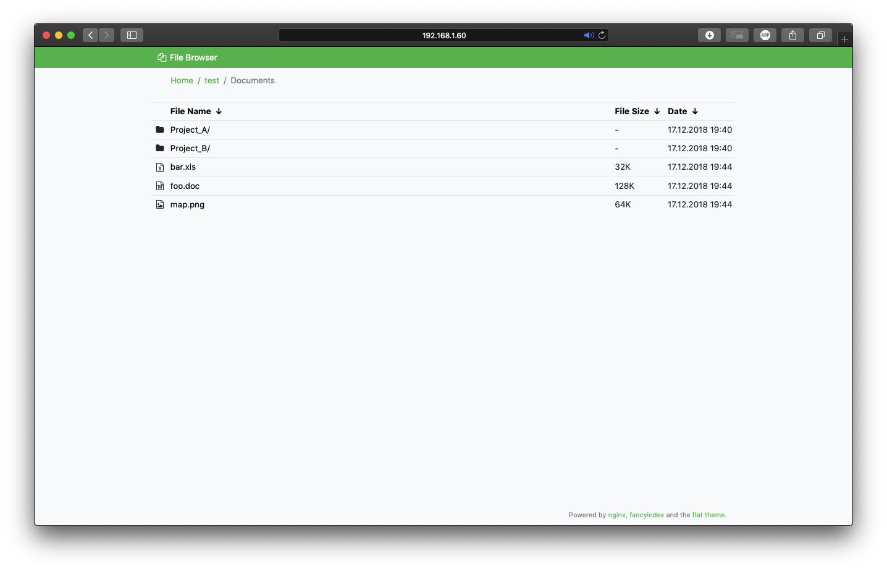

# Flat theme for nginx's fancyindex module

<a href="https://getbootstrap.com/docs">
    
</a>
<a href="https://docs.fontawesome.com/">
    
</a>




## About

The [fancyindex module](https://github.com/aperezdc/ngx-fancyindex) of
[nginx](http://nginx.org/) has the powerful capability to be customizable.
Instead of using an external application, this gives us the ability to use
just the webserver's capabilities to generate beautiful directory listings.

This theme provides a simple, flat interface based on
[Bootstrap 5](https://getbootstrap.com) and [Font Awesome](https://fontawesome.com).

## Usage

1. Get the latest resources from [GitHub releases][releases], or build them
   yourself by running `make` inside this repository. Instructions on how to
   build the resources can be found [below](#build).
2. Copy these files into any location accessible by *nginx*. The theme expects
   to be served under `/theme/`; for any other URL, build it with `THEME_URL`
   (see [below](#serving-the-theme-under-another-url)).
3. Configure your vhost to use the theme's resources for fancyindex:
    ```
    # Fancyindex
    fancyindex             on;
    fancyindex_header      "/theme/header.html";
    fancyindex_footer      "/theme/footer.html";
    fancyindex_show_path   off;
    fancyindex_name_length 255;
    fancyindex_exact_size  off;
    fancyindex_localtime   on;

    # Optional, but recommended: all resources are served locally, so a strict
    # Content-Security-Policy can be used. Note that 'add_header' in a location
    # discards the ones inherited from the server block.
    add_header Content-Security-Policy "default-src 'self'; img-src 'self' data:" always;
    add_header X-Content-Type-Options  nosniff always;

    location /theme/ {
        alias /srv/www/fileserver/theme/;
        # Do not list the theme's own files.
        fancyindex off;
        # The header loads the theme with its version in the URLs, so browsers
        # fetch it again after an update despite this cache.
        expires 7d;
    }
    ```

[releases]: https://github.com/3z3qu13l/nginx-fancyindex-flat-theme/releases


## Build

Instead of using pre-built sources, you can build them on a local machine. You
need [Node.js](https://nodejs.org/en/download) (the version is set in
[.nvmrc](.nvmrc)) and `make` (on Windows, e.g. `choco install make`).

```sh
npm ci
npm run make
npm test
```

The compiled sources for the theme will be located in the `build` directory.
`make` only rebuilds what changed; run `make clean all` for a full rebuild.

`npm run merge` additionally generates `build/header_full.html`, a header with
the theme's CSS and JavaScript inlined. It still needs the `vendor` directory,
and its inline code is not compatible with the Content-Security-Policy above.

### Serving the theme under another URL

The header loads the theme's CSS and JavaScript from `/theme/`. If nginx serves
the `build` directory under another URL, set `THEME_URL` (without trailing
slash) and point `fancyindex_header` and `fancyindex_footer` to that URL:

```sh
make clean all THEME_URL=/fancyindex/theme/flat-theme
```

```
fancyindex_header "/fancyindex/theme/flat-theme/header.html";
fancyindex_footer "/fancyindex/theme/flat-theme/footer.html";
```

On Windows, run it from PowerShell: Git Bash rewrites arguments starting with
`/` into Windows paths, unless prefixed with `MSYS_NO_PATHCONV=1`. From
PowerShell, `make` needs Git's Unix tools in the `PATH` (e.g.
`C:\Program Files\Git\usr\bin`).

## Deployment

The [Deploy](.github/workflows/deploy.yml) workflow builds, tests and copies the
theme to a server over SSH each time a GitHub release is published (except
pre-releases). The previous version is kept in `flat-theme.previous` next to the
deployed `flat-theme`; to roll back, run on the server:

```sh
cd <DEPLOY_DIR> && rm -rf flat-theme && mv flat-theme.previous flat-theme
```

It reads its settings from the `production` environment (Settings >
Environments):

| Name                 | Kind     | Example                                     |
|----------------------|----------|---------------------------------------------|
| `DEPLOY_HOST`        | secret   | `203.0.113.10`                              |
| `DEPLOY_PORT`        | secret   | `22`                                        |
| `DEPLOY_USER`        | secret   | `deploy`                                    |
| `DEPLOY_SSH_KEY`     | secret   | private key, without passphrase             |
| `DEPLOY_KNOWN_HOSTS` | secret   | output of `ssh-keyscan -p <port> <host>`    |
| `THEME_URL`          | variable | `/fancyindex/theme/flat-theme`              |
| `DEPLOY_DIR`         | variable | `/srv/fancyindex/theme`                     |

The SSH user needs write access to `DEPLOY_DIR`, and the server must accept SSH
connections from GitHub's runners. Check the host keys given in
`DEPLOY_KNOWN_HOSTS` against the server's own (`ssh-keygen -lf
/etc/ssh/ssh_host_ed25519_key.pub`), as `ssh-keyscan` trusts whatever answers.

## License

The nginx-fancyindex-flat-theme is free software: you can redistribute it and/or
modify it under the terms of the GNU General Public License as published by the
Free Software Foundation, either version 3 of the License, or (at your option)
any later version.

This software is distributed in the hope that it will be useful, but **WITHOUT
ANY WARRANTY**; without even the implied warranty of **MERCHANTABILITY** or
**FITNESS FOR A PARTICULAR PURPOSE**. A Copy of the GNU General Public License
can be found in the [LICENSE](LICENSE) file.

&copy; 2018-2024 Alexander Haase
